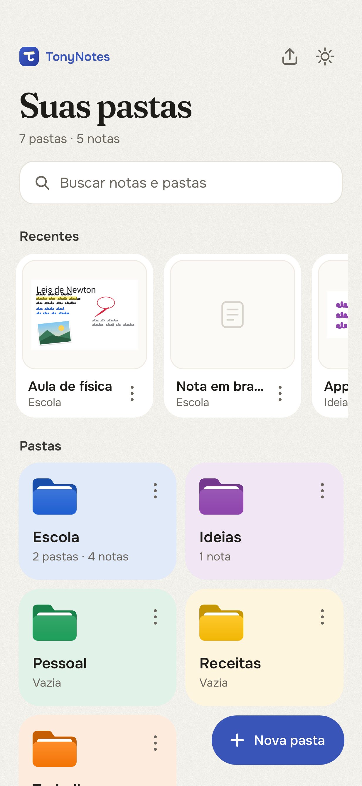
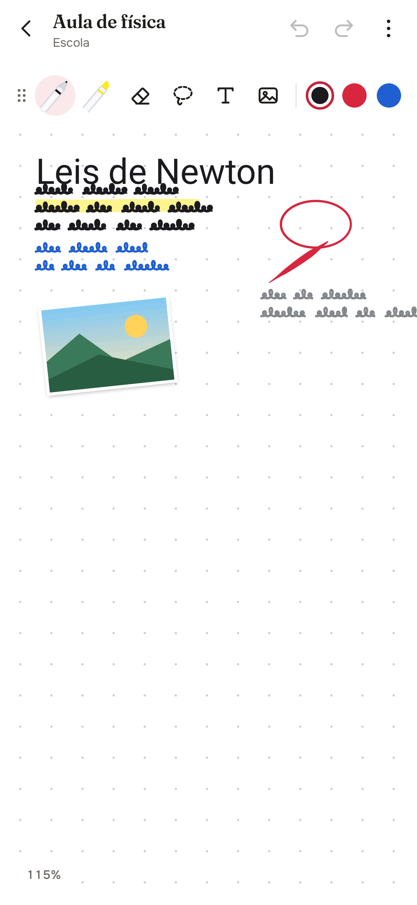
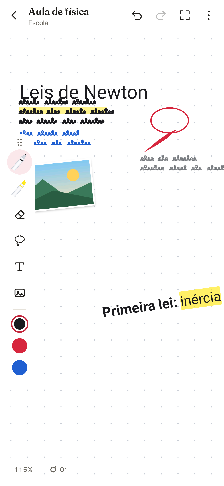
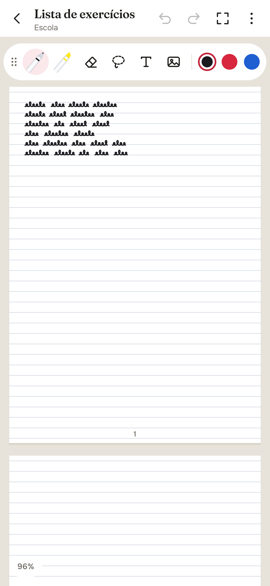

# RosaNotes

App Android (Kotlin) de anotações à mão com **tela infinita na horizontal e na vertical**,
pensado para a S Pen dos Galaxy.

<p>
  
  
  
  
</p>

As capturas em `docs/screenshots` são geradas pelo CI (Robolectric) a cada mudança.

## Como usar

### Pastas (página inicial)
- **Busca** de notas e pastas (ignora acentos).
- O app abre na tela de **Pastas**. Toque em **+** para criar uma pasta (nome e cor).
- Dentro de uma pasta, o **+** cria uma **nota** ou uma **subpasta**.
- Segure uma pasta ou nota para **renomear, mudar a cor, mover, duplicar ou excluir**.
- As notas aparecem com miniatura e data da última alteração.
- **Capa da pasta**: segure a pasta → **Colocar imagem na capa** (galeria ou arquivos).
  A imagem aparece no cartão e no topo da pasta; dá para trocar ou tirar.

### Etiquetas, favoritas e fixadas
- Segure uma nota → **Fixar no topo**, **Favoritar** ou **Etiquetas** (separadas por vírgula).
- A página inicial mostra **Fixadas**, **Favoritas** e as **etiquetas**; tocar numa etiqueta
  filtra as notas (ou busque `#etiqueta`). Dentro da pasta, as fixadas vêm primeiro.

### Busca
- A busca acha pastas e notas pelo **título**, pelas **etiquetas** e pelo **texto digitado**
  dentro das notas, sem ligar para acentos.

### Backup no Google Drive
- **Nota por nota (recomendado)**: na tela de Backup, "Conectar ao Google Drive" faz login com a
  conta Google (escopo `drive.file`: o app só enxerga o que ele mesmo criou). Na pasta **RosaNotes**
  do Drive ficam as mesmas pastas do app e, para cada nota, um **PDF** (para ler no Drive) e um
  arquivo **.rosanota** editável (zip com a nota e as imagens dela, que abre de volta no RosaNotes
  pelo Drive/Compartilhar). Só sobe o que mudou; renomear ou mover renomeia/move lá; nota apagada
  sai do Drive. Um arquivo de índice guarda pastas, cores e capas para o "Restaurar do Drive".
  Backup automático ao sair de uma nota. Requer um projeto no Google Cloud com a Drive API e uma
  credencial OAuth Android (pacote `com.jgantonio.notasinfinitas`, SHA-1 da chave `app/debug.keystore`).
- **Arquivo único (.zip)**, como antes:
- Botão de **backup** no topo da página inicial.
- **Fazer backup agora**: o seletor do Android abre, você escolhe **Drive** (a sua própria
  conta) e salva um `.zip` com todas as pastas, notas, imagens e capas.
- **Backup automático**: escolhe o arquivo uma vez; depois ele é regravado sozinho ao sair
  de uma nota (no máximo a cada 10 minutos).
- **Restaurar**: escolhe um backup e as pastas e notas voltam (útil ao trocar de celular).
- Cada usuário usa o próprio Drive: o app não tem servidor nem conta própria no meio.

### Barra de ferramentas
- Arraste pela **alça ⋮⋮** para levar a barra a qualquer lugar da tela.
- Solta perto da borda **esquerda** ou **direita**, ela fica **em pé** e mostra **3 cores
  rápidas** (toque para usar, toque longo para trocar a cor).
- Um toque na alça abre as posições prontas (topo, esquerda, direita).

### Página
- Menu ⋮ → **Página**: **infinita** (padrão) ou **folhas**.
- **Modelos**: em branco, pontilhado, pautado, quadriculado, **universitário** (com margem),
  **Cornell** (palavras-chave, notas e resumo), **partitura** e **planner semanal**. Os modelos
  aparecem completos com folhas e saem no PDF exportado.
- **Orientação da folha**: vertical (em pé) ou horizontal (deitada).
- **Apresentação das folhas**: uma embaixo da outra ou lado a lado.
- **Folhas infinitas**: uma folha nova aparece sozinha quando você escreve na última.
  Desligado, escolha o número de folhas.
- O PDF exportado sai com uma página por folha.

### Tema noturno
- Botão de sol/lua na página inicial, ou menu ⋮ → **Tema**: igual ao celular, claro ou noturno.
- No noturno, a nota de papel claro aparece escura e a tinta se inverte mantendo o tom de
  cada cor (o vermelho continua vermelho). Miniaturas e exportações saem com as cores reais.

### Editor
- **S Pen** escreve; segurando o **botão lateral**, apaga (dá para desligar).
- **1 dedo** move a tela em qualquer direção; **2 dedos** dão zoom (5% a 800%).
- Menu ⋮ → **Dedo: escreve** faz o dedo também escrever (aí 2 dedos movem).

### Canetas (toque de novo na caneta, ou na bolinha de cor, para abrir a bandeja)
- **Caneta-tinteiro**, **Caneta**, **Lápis** (grão de grafite do tamanho dos pixels da tela, em qualquer zoom), **Caligrafia** (bico chato
  inclinado) e **Pincel** (pressão forte e pontas afinadas).
- O **Marca-texto** tem **botão próprio** na barra, separado das canetas; o botão da caneta
  volta sempre para a última caneta usada.
- **Marca-texto acompanha a altura da escrita**: passando sobre letras escritas à mão, a
  faixa fica da altura delas; longe da escrita, vale o tamanho escolhido (dá para desligar
  na bandeja do marca-texto).
- Cada pincel lembra sua **espessura**, **opacidade** e **cor**.
- **Marca-texto** com ponta chanfrada: **tamanho**, **transparência**, **espessura da ponta**
  e **endireitar linhas** (o traço vira uma reta, perfeitamente horizontal quando quase).
  O marca-texto fica sempre **por baixo da escrita** (a letra continua nítida), inclusive
  enquanto se passa; sobre um PDF ou uma imagem ele continua visível.
- **Segurar para endireitar**: com qualquer caneta, faça um traço e segure a caneta parada
  no fim (~0,5 s): ele vira uma reta, e mover a caneta ajusta a ponta antes de soltar.
- Paleta de cores + **cor personalizada** (espectro, matiz, **tons da cor escolhida** do
  mais claro ao mais escuro e código hex); as cores personalizadas ficam salvas.
- **Formas automáticas**: linha reta, círculo/elipse, triângulo, retângulo, pentágono.
- **Favoritos**: salve combinações de caneta e use pela barra (segure para remover).

### Caneta com latência mínima
- A tinta em andamento é desenhada direto no buffer da tela (front buffer), sem
  esperar o próximo quadro, e a nota não é redesenhada a cada ponto.
- Em Android 14+, previsão de movimento quando o front buffer não está disponível.
- O editor pede a taxa de atualização máxima da tela (ex.: 120 Hz).
- A previsão de movimento entra no próprio traço (mesma textura e transparência).
- Traços translúcidos (marca-texto, lápis) são desenhados sem camada extra por traço.
- O front buffer é **experimental e vem desligado**: ligue no menu ⋮ ("Tinta de latência
  mínima (experimental)"). Se a camada falhar no meio do traço, ele continua pelo caminho
  normal; a camada é recriada ao voltar para a nota.

### Texto (como no Samsung Notes)
- Toque com a ferramenta **T** e digite direto na tela. A barra acima do teclado tem
  fonte, tamanho, **negrito**, *itálico*, sublinhado, tachado, alinhamento, cor e
  marca-texto. Com um trecho selecionado, o estilo vale só para o trecho.
- Toque de novo num texto selecionado para editar. Com a seleção: girar (alça ou 90°),
  aumentar/diminuir, espelhar, virar, endireitar, cor, frente/trás, duplicar e excluir.

### Áudio junto com a escrita
- Menu ⋮ → **Gravar áudio com a escrita**. Cada traço feito durante a gravação guarda o
  momento do áudio.
- **Rolagem presa em documentos** (⋮ › Ajustes, ligada): em cima de um PDF/PowerPoint ou das
  folhas, arrastar a tela só anda no sentido das páginas; empurrando bem para o lado, solta.
- **Rejeição de palma** (menu ⋮ › Ajustes, ligada por padrão): com caneta ativa, a caneta ganha
  da mão (a palma que encostou antes não mexe a tela) e a mão é ignorada enquanto a caneta está
  perto ou logo depois; escrevendo com dedo/caneta comum, toques grandes são ignorados e, com
  vários toques, escreve o que fica acima e do lado oposto à mão (opção "mão esquerda").
  **Protetor de mão** opcional, onde a mão pode encostar: faixa embaixo (horizontal), faixa na
  lateral (vertical, do lado da mão) ou ilha livre; arraste pela alça para mover e pelo canto
  para mudar o tamanho (fica lembrado).
- Selecione a escrita → **Ouvir daqui**: o áudio toca a partir de quando aquilo foi escrito.
- **Painel de áudio** em cima da nota (dá para escrever ouvindo): tocar/pausar, barra para
  avançar, −10s/+10s e velocidade de 0,5x a 2x. Gravando: pausar/continuar e parar.
  Arraste pela alça (⠿) para qualquer lugar da tela, ou minimize (˅) para uma bolinha só com o
  tempo e o botão de pausar; o lugar e o modo ficam lembrados.
- **Gravações** (menu ⋮): lista com nome, duração e data; renomear, compartilhar/exportar,
  salvar em Downloads e apagar.
- **Gravação à prova de falhas**: o áudio é gravado em AAC contínuo (ADTS) e a lista é salva
  enquanto grava; se o app fechar ou o celular desligar, o que já foi gravado continua tocando.
- No backup do Drive, todos os áudios ficam na pasta **RosaNotes/Gravações**, com o nome da nota.
- Menu ⋮ → **Áudios da nota**: tocar ou apagar as gravações.

### Apresentar
- Menu ⋮ → **Ponteiro laser** (rastro vermelho que some na hora) ou **Tinta que some**
  (fica alguns segundos e desaparece). Nada disso entra na nota.

### Imagens e PDF
- Toque na imagem com a seleção: girar livre (com ímã nos ângulos retos), recortar
  (livre, 1:1, 16:9, círculo, à mão livre), ajustes (filtros, brilho, contraste,
  saturação, opacidade), cantos, moldura, sombra, espelhar, travar, substituir,
  salvar na galeria.
- PDF: importa todas as páginas em coluna, lado a lado ou em grade, travadas como
  fundo. Tocando numa página aparecem as **mesmas ferramentas da imagem** (recortar,
  ajustes, girar, espelhar, salvar...); travada, ela só não sai do lugar ao escrever por cima.
- **PowerPoint** (`PptxImporter.kt`): Inserir › PowerPoint, ou Compartilhar/Abrir com o
  RosaNotes, traz cada slide como página travada (igual ao PDF). Com o Google Drive conectado,
  o Google converte em PDF com visual idêntico (arquivo temporário apagado logo depois);
  sem Drive ou sem internet, o leitor próprio desenha offline fundo, formas, textos,
  imagens e tabelas (aproximado). `.ppt` antigo só abre pelo Google.
- **Páginas numeradas e sumário**: cada página de PDF/PowerPoint mostra "3 / 12" no canto
  (só na tela, não sai na exportação). O botão **Sumário** na barra de cima (aparece quando a
  nota tem documentos) lista os documentos com miniatura e abre a grade de páginas; tocar numa
  página leva até ela. Depois do pulo aparece **Voltar** no canto de baixo, que devolve a tela
  ao ponto de antes (mesma posição, zoom e ângulo).
- **Exportar PDF anotado**: menu ⋮ gera um PDF com as mesmas páginas, no tamanho original,
  com tudo o que foi escrito por cima.
- **Importar do Samsung Notes** (`SamsungNotesImporter.kt`): lê o arquivo `.sdocx`
  (Compartilhar › Arquivo do Samsung Notes) e traz a escrita à mão **editável**: traços
  com cor, espessura, pressão e tipo de caneta, título, texto, caixas de texto e imagens.
  Vários arquivos de uma vez, pelo seletor ou pelo Compartilhar do Samsung Notes.
  Formato conforme a engenharia reversa de twangodev/sdocx e bxff/samsung-notes-format.

### Outras ferramentas
- **Formas prontas** (Inserir › Forma): retângulo, quadrado, elipse, círculo, triângulo, linha,
  seta, seta dupla e tabela (linhas × colunas), com a cor e a espessura da caneta; viram traços
  comuns, editáveis.
- **Régua** (Inserir › Régua ou menu ⋮): um dedo arrasta, dois giram (ímã a cada 15°); o traço
  de caneta que começa perto da borda corre reto colado nela. Marcas em mm/cm pelo tamanho real da tela.
- **Fita para esconder** (botão na barra): arraste para cobrir respostas e termos; toque na fita
  (com qualquer ferramenta) para revelar e esconder. O menu ⋮ mostra/esconde todas. Fitas
  reveladas não saem nas exportações.
- **Marcadores** (menu ⋮): marque partes da nota com um título e volte a elas com um toque.
- **Cartões de estudo**: selecione a pergunta › **Criar cartão**, selecione a resposta › **Usar
  como resposta**. Menu ⋮ › Revisar: pergunta, resposta e Errei/Difícil/Fácil, com repetição
  espaçada (caixas de 0, 1, 3, 7, 14 e 30 dias). Os cartões mostram sempre a versão atual da nota.
- **Folhas em miniatura** (menu ⋮ › Folhas): grade com as folhas da nota; toque para ir até
  uma, e ⋯ para mover para cima/baixo, duplicar, inserir folha em branco ou excluir.
- **Lixeira**: notas excluídas (e as de pastas excluídas) ficam 30 dias na lixeira da tela
  inicial, com Restaurar, Apagar de vez e Esvaziar.
- **Conta-gotas e balde** (na bandeja das canetas): pegar a cor de qualquer coisa da nota e
  pintar o interior de uma forma fechada feita com um traço (o preenchimento fica por baixo).
- **Copiar e colar**: selecione e toque em **Copiar** (ou Recortar); a pílula **Colar** ao lado do
  zoom cola no centro da tela, na mesma nota ou em outra (vale para traços, textos, imagens e PDF).
- **Print da área**: desenhe um laço ou retângulo com a seleção (mesmo sobre um PDF travado) e
  toque em **Print da área**: tudo o que aparece dentro do contorno vira uma imagem para colar.
  Com uma área sobre um PDF ou imagem, **Copiar** leva só o pedaço recortado pelo contorno (por
  baixo) e a escrita selecionada continua editável. **Copiar página** (tocando na página) e
  **Copiar página inteira** (com a área) levam a página toda com o que está escrito nela; no painel
  de Folhas há **Copiar folha**.
- **Compartilhar e imprimir** (menu ⋮): manda a nota como PDF ou imagem para qualquer app e
  imprime pelo Android. O RosaNotes também **recebe PDFs** compartilhados de outros apps.
- **Girar a tela**: a pílula de ângulo ao lado do zoom abre um controle de -180° a 180°
  (com ímã nos ângulos retos, botões de ±15° e ±90° e "Endireitar"). Só a visão gira: a
  escrita, as exportações e as miniaturas continuam retas. O ângulo fica salvo na nota.
- Tocar na alça ⋮⋮ abre a **bandeja de posição da barra** colada nela (topo, esquerda, direita).
- **Tela cheia** (botão ⛶ no canto da barra de cima): somem a barra de cima e as do sistema;
  fica só a barra de ferramentas e, num cantinho, desfazer, refazer e sair (o voltar também sai).
- **Borracha** (toque de novo para opções): **borracha de traço** ou **borracha de área**,
  tamanho, **apagar somente marca-texto**, apagar tudo.
- **Seleção** (toque de novo para opções): **laço** ou **retângulo**, e **incluir objetos
  parcialmente selecionados**. Depois **mova**, **redimensione**, **duplique**,
  **mude a cor** ou **exclua**.
- **Texto**: toque na tela para digitar; toque num texto existente para editar.
- **Imagem**: insere uma foto da galeria (já vem selecionada para posicionar).
- **Modelo da página**: em branco, pontilhado, pautado ou quadriculado, e cor do papel.
- **Desfazer / Refazer**, **Exportar PNG** (Imagens/RosaNotes) e
  **Exportar PDF** (Downloads/RosaNotes).
- Tudo é salvo automaticamente ao sair da nota.

## Visual
Direção definida com o Taste Skill (redesign), as Web Interface Guidelines da Vercel e o
DESIGN.md do Notion (Awesome Design): papel quente, um único acento cor de tinta, títulos em
**Fraunces** e interface em **Onest** (fontes OFL em `app/src/main/assets/fonts`, com licenças).
Todos os pares de texto/fundo passam no contraste WCAG AA (auditado com o Playwright CLI).

## Como instalar
O repositório é público. Cada versão do `main` que passa nos testes vira uma **Release**
(tag `rosanotes-v<versão>-build<N>`), e este link sempre baixa a mais recente (é o botão do site):
`https://github.com/jgantonio93-arch/tonynotes/releases/latest/download/RosaNotes.apk`
(o APK de cada execução também fica no artefato `rosanotes-apk` da aba **Actions**).
Instale o `.apk` permitindo "instalar apps desconhecidos".

O APK é assinado com uma chave de debug fixa (`app/debug.keystore`), então as versões
novas instalam por cima das antigas sem perder as notas.

**Aviso de atualização:** ao abrir, o app consulta a última Release no GitHub e compara o
`buildN` da tag com o próprio `BuildConfig.BUILD_NUMBER` (o número da execução do CI que o
gerou). Se houver versão mais nova, aparece um painel com o botão **Atualizar**; se estiver em
dia ou sem internet, nada aparece. Builds locais (número 0) não consultam (`Updates.kt`).

## Compilar localmente
Requer JDK 17 e Android SDK (Android Studio):

```
./gradlew assembleDebug
```

## Próximos passos
- Régua e transferidor
- Lupa de escrita (zoom box)
- Camadas
- Plano Pro (Google Play Billing) e publicação na Play Store
